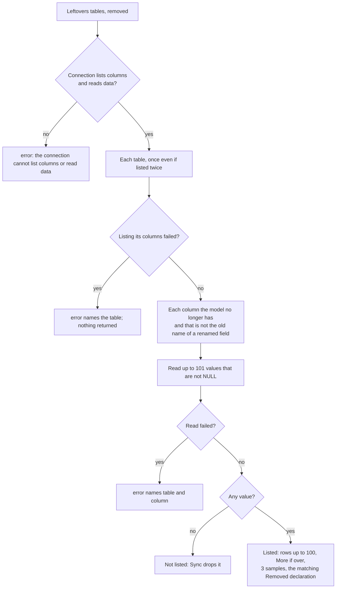

> Read AGENTS.md at the repo root before any change.
> **Finish by yourself:** when the delivery check passes, commit, push and open the pull request. Never ask whether to
> proceed or finalize — nobody answers, and a session that waits ends without your work.

# webtyp/ddl — columns that stayed because they hold data

> Executed locally on 2026-11-05: `gotest` green (tests index included); new conformance clauses verified against
> `sqlt` with a temporary `replace`: `drop_column` passes, `copy_column` fails with «unknown DDL op» until `sqlt` renders `OpCopyColumn`.

## Why

`Sync` never drops a column that still holds data (good: it protects production), but it only writes a log line
(`sync.go`, «safe drop skip: column … has data») and returns `nil`. Nobody sees it: a developer removed `timezone` from a
model and the column stayed in the database with one value, unnoticed. The app's development tool (`webtyp dev`) will
show those columns and ask «drop it? yes / no». For that, `ddl` must:

1. **List** them, read-only, with how many rows hold a value and up to 3 example values — `DB.Leftovers`.
2. **Drop** one when the developer says yes — `DB.DropColumn`.
3. **Copy** a removed column into the column that replaced it, before dropping — `DB.CopyColumn`, backed by a new
   `OpCopyColumn` that `webtyp/postgres` and `webtyp/sqlt` learn to render in their own plans (not here).

Each module keeps calling `Sync` exactly as today; nothing in `Sync`'s behaviour changes. The caller (`webtyp/migrate`,
in a later plan) gets the models from `ddl.Capture` and calls `Leftovers` after running the steps.

## Tools

```bash
go install webtyp.com/devflow/cmd/gotest@latest
go install webtyp.com/lang/cmd/langc@latest
export GOPRIVATE=webtyp.com/*,github.com/veltylabs/* GOFLAGS=-mod=mod
```
Dependencies stay as pinned in `go.mod` (`webtyp.com/storage v0.1.18`, `webtyp.com/model v0.2.12`, `webtyp.com/fmt v1.0.0`).

## Ecosystem search

- `ddl.Capture` (`capture.go`) already returns `[]ddl.Table{Step, Model}` for an app's migration list → **reused** as
  the input of `Leftovers`; no new way to collect models.
- `Sync`'s safe-drop probe (`sync.go` step 6) already compiles `SELECT <col> … WHERE <col> IS NOT NULL LIMIT n` through
  `storage.Compiler` → **reused**: the anonymous probe interface becomes the named `prober` type, shared by both.
- `storage` has no `COUNT` action (`storage@v0.1.18/query.go`: Create, ReadOne, Update, Delete, ReadAll) → rows are
  counted by reading at most `LeftoverRowCap + 1` values.
- `ddl.Stmt` cannot express `UPDATE t SET a = b`, nor can `storage.Query` (values only, no column reference) → **new**
  `OpCopyColumn`.

## Design gate

1. **Prior art:** Rails `remove_column` / Django `RemoveField` need an explicit migration and drop blindly; Atlas and
   `sqldef` print a plan («drop column x») before applying. Here: `Sync` keeps protecting, `Leftovers` is the plan,
   `DropColumn` the explicit apply.
2. **Novice-name test:** «leftovers» = what stayed behind; `DropColumn(table, column)`; `CopyColumn(removed)`. `Removed`
   reads as «a column that was removed from the model».
3. **Complexity ledger:** +2 types (`Removed`, `Leftover`), +3 methods, +1 `Op`, +2 constants. Zero changes for the 18
   module `Migrate` functions (option «Sync returns leftovers» rejected: it changed every one of them).
4. **Where it belongs:** `ddl` owns schema reconciliation and already owns the probe; `migrate` only orchestrates.
5. **What it deletes:** the anonymous probe interface in `sync.go` (replaced by `prober`).

## APIs used

| Symbol | Exact signature | Tag | File |
|---|---|---|---|
| `storage.Query` | `struct{ Action Action; Table string; Columns []string; Values []any; Conditions []Condition; OrderBy []Order; GroupBy []string; Limit int; Offset int }` | `webtyp.com/storage v0.1.18` | `query.go` |
| `storage.ActionReadAll`, `storage.ActionCreate` | `storage.Action` constants | v0.1.18 | `query.go` |
| `storage.IsNotNull` | `func IsNotNull(field string) Condition` | v0.1.18 | `conditions.go` |
| `storage.Compiler` | `interface{ Compile(q Query, m model.Model) (Plan, error) }` | v0.1.18 | `compiler.go` |
| `storage.Plan` | `struct{ Mode Action; Query string; Args []any }` | v0.1.18 | `execution_plan.go` |
| `storage.Rows` | `interface{ Next() bool; Scan(dest ...any) error; Columns() ([]string, error); Close() error; Err() error }` | v0.1.18 | `executor.go` |
| `storage.Conn` | has `Exec(query string, args ...any) error` and `Query(query string, args ...any) (Rows, error)` plus `Compile` | v0.1.18 | `executor.go` |
| `conformance.Widget`, `conformance.WidgetModel` | fields `id` text PK, `name` text not null, `qty` int not null, `active` bool not null, `note` text nullable | v0.1.18 | `webtyp.com/storage/conformance/model.go` |
| `fmt.Convert(v ...any) *Conv`, `(*Conv).String() string` | | `webtyp.com/fmt v1.0.0` | `convert.go` |
| `fmt.Err(...any) error`, `fmt.Errf(format string, args ...any) error` | already used in `sync.go` / `capture.go` | v1.0.0 | |

In this repo: `TableIntrospector` (`TableColumns(table string) ([]string, error)`), `RenameProvider`,
`contains`, `schemaHasColumn`, `isRenameSource`, `DB.execDDL(s Stmt, m model.Model) error`, `Table{Step, Model}`.

If a signature in the published tag differs from this table, stop and name the symbol in the PR; never adapt it by guessing.

## Stage 1 — Diagram

New file `docs/diagrams/LEFTOVERS_FLOW.md` (context header, mermaid, numbered walkthrough — **documentation** template):

````markdown
# Leftovers flow

`DB.Leftovers(tables, removed)` lists the columns a database keeps although the model no longer has them, because
they still hold data (`Sync` never drops those). You run into it when `webtyp dev` shows the DATABASE tab, or when a
production server warns at start. It only reads. Each branch has a test in `tests/leftovers_test.go`.



1. Without `TableIntrospector` and a DML half (`Compile` + `Query`) there is no evidence: it fails loudly.
2. A table that appears twice (two steps) is read once.
3. A column that is the old name of a renamed field (`db:"old_name=…"`) is `Sync`'s business: never listed.
4. Counting stops at 100: a production table is never read whole at start.
5. A `Removed` declaration whose table and column match is attached; one that matches nothing is ignored.
````

Also add one line under the diagram in `docs/diagrams/SYNC_FLOW.md`, after its mermaid block:
`A column kept because it holds data is what DB.Leftovers lists: [LEFTOVERS_FLOW.md](LEFTOVERS_FLOW.md).`

Commit.

## Stage 2 — Red tests

New file `tests/setup_test.go` (`package ddl_test`) with these fakes, written exactly:

```go
package ddl_test

import (
	"webtyp.com/ddl"
	"webtyp.com/model"
	"webtyp.com/storage"
)

// tableCols is one table's columns in the fake database (no map: AGENTS.md).
type tableCols struct {
	table string
	cols  []string
}

// fakeConn lists columns per table and returns values for every probe query.
type fakeConn struct {
	tables   []tableCols
	colsErr  error
	values   []any // what every probe query returns, one row per value
	queryErr error
	queries  int // probe queries run
}

func (c *fakeConn) Exec(string, ...any) error { return nil }
func (c *fakeConn) Compile(q storage.Query, m model.Model) (storage.Plan, error) {
	return storage.Plan{Query: "probe " + q.Table + "." + q.Columns[0]}, nil
}
func (c *fakeConn) Query(string, ...any) (storage.Rows, error) {
	c.queries++
	if c.queryErr != nil {
		return nil, c.queryErr
	}
	return &fakeRows{values: c.values}, nil
}
func (c *fakeConn) TableColumns(table string) ([]string, error) {
	if c.colsErr != nil {
		return nil, c.colsErr
	}
	for _, t := range c.tables {
		if t.table == table {
			return t.cols, nil
		}
	}
	return nil, nil
}

// execOnly has Exec and nothing else: it cannot probe.
type execOnly struct{}

func (execOnly) Exec(string, ...any) error { return nil }

type fakeRows struct {
	values []any
	i      int
}

func (r *fakeRows) Next() bool {
	if r.i < len(r.values) {
		r.i++
		return true
	}
	return false
}
func (r *fakeRows) Scan(dest ...any) error { *(dest[0].(*any)) = r.values[r.i-1]; return nil }
func (r *fakeRows) Columns() ([]string, error) { return nil, nil }
func (r *fakeRows) Close() error               { return nil }
func (r *fakeRows) Err() error                 { return nil }

// recordingCompiler is a ddl.Compiler that keeps every statement.
type recordingCompiler struct{ stmts []ddl.Stmt }

func (c *recordingCompiler) CompileDDL(s ddl.Stmt, m model.Model) (string, []any, error) {
	c.stmts = append(c.stmts, s)
	return "ddl", nil, nil
}

// testModel is a model with a table name and fields; renamed fills OldNames.
type testModel struct {
	table  string
	fields []model.Field
}

func (m *testModel) ModelName() string              { return m.table }
func (m *testModel) Schema() []model.Field          { return m.fields }
func (m *testModel) Pointers() []any                { return nil }
func (m *testModel) IsNil() bool                    { return m == nil }
func (m *testModel) EncodeFields(model.FieldWriter) {}
func (m *testModel) DecodeFields(model.FieldReader) {}

type renamedModel struct {
	testModel
	oldNames map[string]string
}

func (m *renamedModel) OldNames() map[string]string { return m.oldNames }

func calendarConfig() *testModel {
	return &testModel{table: "work_calendar_config", fields: []model.Field{{Name: "id", Type: model.Text()}}}
}
```

New file `tests/leftovers_test.go`. Each test: setup → call → expected. `tbl := ddl.Table{Step: "business_calendar", Model: calendarConfig()}`
and, unless the row says otherwise, `conn := &fakeConn{tables: []tableCols{{"work_calendar_config", []string{"id", "timezone"}}}}`,
`db := ddl.New(conn, &recordingCompiler{})`.

| Test | Setup | Call | Expected |
|---|---|---|---|
| `TestLeftovers_ColumnWithDataIsListedWithRowsAndSamples` | `conn.values = []any{"America/Santiago"}` | `db.Leftovers([]ddl.Table{tbl}, nil)` | `err == nil`; `len == 1`; `[0]` is `{Table: "work_calendar_config", Column: "timezone", Rows: 1, More: false, Samples: []string{"America/Santiago"}, Removed: ddl.Removed{}}` |
| `TestLeftovers_EmptyColumnIsNotListed` | `conn.values = nil` | same | `err == nil`; `len == 0` |
| `TestLeftovers_CountStopsAtTheCap` | `conn.values` = 150 values `"v0"`…`"v149"` | same | `[0].Rows == ddl.LeftoverRowCap` (100); `[0].More == true`; `[0].Samples == []string{"v0","v1","v2"}` |
| `TestLeftovers_DeclarationIsAttached` | `values = []any{"America/Santiago"}`; `removed = []ddl.Removed{{Table: "holiday", Column: "label", Note: "x"}, {Table: "work_calendar_config", Column: "timezone", Note: "moved to config.App.Zone"}}` | `db.Leftovers([]ddl.Table{tbl}, removed)` | `[0].Removed == removed[1]` |
| `TestLeftovers_RenameSourceIsNotListed` | model `&renamedModel{testModel: testModel{table: "work_calendar_config", fields: []model.Field{{Name: "id", Type: model.Text()}, {Name: "zone", Type: model.Text()}}}, oldNames: map[string]string{"zone": "timezone"}}`; `values = []any{"x"}` | `db.Leftovers([]ddl.Table{{Step: "s", Model: m}}, nil)` | `len == 0`; `conn.queries == 0` |
| `TestLeftovers_SameTableTwiceIsReadOnce` | `values = []any{"x"}` | `db.Leftovers([]ddl.Table{tbl, tbl}, nil)` | `len == 1`; `conn.queries == 1` |
| `TestLeftovers_ConnectionWithoutProbeFails` | `db := ddl.New(execOnly{}, &recordingCompiler{})` | `db.Leftovers([]ddl.Table{tbl}, nil)` | `err.Error() == "ddl: leftovers: the connection cannot list columns or read data"`; result `nil` |
| `TestLeftovers_ListColumnsErrorStops` | `conn.colsErr = errors.New("down")` | same as row 1 | `err != nil`; `strings.Contains(err.Error(), "work_calendar_config")`; `strings.Contains(err.Error(), "down")`; result `nil` |
| `TestLeftovers_ReadErrorStops` | `conn.queryErr = errors.New("down")` | same | `err != nil`; message contains `"work_calendar_config"`, `"timezone"`, `"down"` |

New file `tests/column_test.go`:

| Test | Setup | Call | Expected |
|---|---|---|---|
| `TestDropColumn_EmitsDropColumn` | `comp := &recordingCompiler{}`; `db := ddl.New(execOnly{}, comp)` | `db.DropColumn("work_calendar_config", "timezone")` | `err == nil`; `comp.stmts[0] == ddl.Stmt{Op: ddl.OpDropColumn, Table: "work_calendar_config", ColumnName: "timezone"}` |
| `TestDropColumn_EmptyNameFails` | same | `db.DropColumn("work_calendar_config", "")` | `err.Error() == "ddl: drop column: table and column are required"`; `len(comp.stmts) == 0` |
| `TestCopyColumn_EmitsCopyColumn` | same | `db.CopyColumn(ddl.Removed{Table: "holiday", Column: "label", MovedTo: "name"})` | `comp.stmts[0] == ddl.Stmt{Op: ddl.OpCopyColumn, Table: "holiday", OldName: "label", ColumnName: "name"}` |
| `TestCopyColumn_WithoutMovedToFails` | same | `db.CopyColumn(ddl.Removed{Table: "holiday", Column: "label"})` | `err.Error() == "ddl: copy column: table, column and moved-to are required"`; `len(comp.stmts) == 0` |

Run `gotest`: these fail to compile (red). Commit.

## Stage 3 — Code

**`compiler.go`** — append to the `Op` block, after `OpDropColumn` (never reorder existing values):
```go
	// OpCopyColumn copies OldName into ColumnName on every row where ColumnName is NULL and OldName is not:
	// UPDATE <Table> SET <ColumnName> = <OldName> WHERE <ColumnName> IS NULL AND <OldName> IS NOT NULL.
	OpCopyColumn
```
and extend the `ColumnName` comment in `Stmt`: «… currently OpDropColumn, and the destination of OpCopyColumn (its
source is OldName)». `OldName`'s comment becomes `// for RenameColumn, and the source column of CopyColumn`.

**New file `leftovers.go`:**
```go
package ddl

import (
	"webtyp.com/fmt"
	"webtyp.com/model"
	"webtyp.com/storage"
)

const (
	// LeftoverRowCap is how many rows Leftovers counts per column; beyond it, Leftover.More is true.
	LeftoverRowCap = 100
	// LeftoverSamples is how many example values Leftovers returns per column.
	LeftoverSamples = 3

	errLeftoversNoProbe = "ddl: leftovers: the connection cannot list columns or read data"
	// composed so langc shares "are required" (reuse rule)
	errDropColumn       = "ddl: drop column:"
	errCopyColumn       = "ddl: copy column:"
	errTableAndColumn   = "table and column"
	errTableColumnMoved = "table, column and moved-to"
	errRequired         = "are required"
)

// Removed is a column a model no longer has, and where its data went. An app declares it; webtyp dev writes it.
//
//	ddl.Removed{Table: "work_calendar_config", Column: "timezone", Note: "moved to config.App.Zone"}
type Removed struct {
	Table   string // table that still has the column
	Column  string // the column the model no longer has
	MovedTo string // column of the same table that receives the data (CopyColumn); "" = none
	Note    string // where the data went, in plain words; "" = nobody said
}

// Leftover is a column the database keeps although the model no longer has it, because it holds data.
type Leftover struct {
	Table   string
	Column  string
	Rows    int      // rows with a value, counted up to LeftoverRowCap
	More    bool     // true when there are more than LeftoverRowCap
	Samples []string // up to LeftoverSamples values, in the order the database returns them
	Removed Removed  // the declaration for this column; zero value when there is none
}

// prober is the DML half Sync and Leftovers need to ask whether a column holds data.
type prober interface {
	storage.Compiler
	Query(query string, args ...any) (storage.Rows, error)
}

// Leftovers lists, read-only, the columns of the given tables that the models no longer have but still hold data.
// tables usually comes from Capture; a table listed twice is read once.
//
//	tables, _ := ddl.Capture(steps)
//	left, err := ddl.New(conn, compiler).Leftovers(tables, config.Removed)
func (d *DB) Leftovers(tables []Table, removed []Removed) ([]Leftover, error) {
	introspector, canList := d.conn.(TableIntrospector)
	p, canProbe := d.conn.(prober)
	if !canList || !canProbe {
		return nil, fmt.Err(errLeftoversNoProbe)
	}
	var out []Leftover
	var seen []string
	for _, t := range tables {
		name := t.Model.ModelName()
		if contains(seen, name) {
			continue
		}
		seen = append(seen, name)
		cols, err := introspector.TableColumns(name)
		if err != nil {
			return nil, fmt.Errf("%s: list columns: %v", name, err)
		}
		var oldNames map[string]string
		if rp, ok := t.Model.(RenameProvider); ok {
			oldNames = rp.OldNames()
		}
		for _, col := range cols {
			if schemaHasColumn(t.Model.Schema(), col) || isRenameSource(oldNames, col) {
				continue
			}
			l, err := probeColumn(p, t.Model, name, col)
			if err != nil {
				return nil, err
			}
			if l.Rows == 0 {
				continue
			}
			l.Removed = findRemoved(removed, name, col)
			out = append(out, l)
		}
	}
	return out, nil
}

// probeColumn reads at most LeftoverRowCap+1 non-NULL values of col.
func probeColumn(p prober, m model.Model, table, col string) (Leftover, error) {
	plan, err := p.Compile(storage.Query{
		Action:     storage.ActionReadAll,
		Table:      table,
		Columns:    []string{col},
		Conditions: []storage.Condition{storage.IsNotNull(col)},
		Limit:      LeftoverRowCap + 1,
	}, m)
	if err != nil {
		return Leftover{}, fmt.Errf("%s: read column %s: %v", table, col, err)
	}
	rows, err := p.Query(plan.Query, plan.Args...)
	if err != nil {
		return Leftover{}, fmt.Errf("%s: read column %s: %v", table, col, err)
	}
	defer rows.Close()
	l := Leftover{Table: table, Column: col}
	for rows.Next() {
		if l.Rows == LeftoverRowCap {
			l.More = true
			break
		}
		l.Rows++
		if len(l.Samples) < LeftoverSamples {
			var v any
			if err := rows.Scan(&v); err != nil {
				return Leftover{}, fmt.Errf("%s: read column %s: %v", table, col, err)
			}
			l.Samples = append(l.Samples, fmt.Convert(v).String())
		}
	}
	if err := rows.Err(); err != nil {
		return Leftover{}, fmt.Errf("%s: read column %s: %v", table, col, err)
	}
	return l, nil
}

func findRemoved(removed []Removed, table, col string) Removed {
	for _, r := range removed {
		if r.Table == table && r.Column == col {
			return r
		}
	}
	return Removed{}
}

// DropColumn drops one column, data included. Only for a decision a person made (webtyp dev's «yes»).
//
//	err := db.DropColumn("work_calendar_config", "timezone")
func (d *DB) DropColumn(table, column string) error {
	if table == "" || column == "" {
		return fmt.Err(errDropColumn, errTableAndColumn, errRequired)
	}
	return d.execDDL(Stmt{Op: OpDropColumn, Table: table, ColumnName: column}, nil)
}

// CopyColumn copies r.Column into r.MovedTo on the rows where r.MovedTo is empty, before the column is dropped.
//
//	err := db.CopyColumn(ddl.Removed{Table: "holiday", Column: "label", MovedTo: "name"})
func (d *DB) CopyColumn(r Removed) error {
	if r.Table == "" || r.Column == "" || r.MovedTo == "" {
		return fmt.Err(errCopyColumn, errTableColumnMoved, errRequired)
	}
	return d.execDDL(Stmt{Op: OpCopyColumn, Table: r.Table, OldName: r.Column, ColumnName: r.MovedTo}, nil)
}
```

**`sync.go`** — replace the anonymous interface in step 6 with the named type:
```go
	p, canProbe := d.conn.(prober)
```
and rename the uses of `prober.` in that function to `p.`. Nothing else in `sync.go` changes (the log line stays).
Deletion criterion: `grep -n "Query(query string, args ...any) (storage.Rows, error)" sync.go` → empty.

Anti-footgun: do **not** change `Sync`'s return type or make it call `Leftovers`; module migrations must keep compiling
unchanged. Do not add a `map` (AGENTS.md); `oldNames` is only read, as in `Sync`.

`gotest` green. Commit.

## Stage 4 — Conformance

In `conformance/conformance.go`, append two clauses to `Run`, so `postgres` and `sqlt` prove `OpCopyColumn` and
`DropColumn` against a real engine (their own plans add the rendering; until then their conformance run fails on
`copy_column`, which is the point). Helper in the same file:

```go
// insertWidget writes one Widget row through the DML half of conn.
func insertWidget(t *testing.T, conn storage.Conn, id, note string) {
	t.Helper()
	w := &conformance.Widget{}
	plan, err := conn.Compile(storage.Query{
		Action:  storage.ActionCreate,
		Table:   w.ModelName(),
		Columns: []string{"id", "name", "qty", "active", "note"},
		Values:  []any{id, "n", 1, true, note},
	}, w)
	if err != nil {
		t.Fatalf("compile insert: %v", err)
	}
	if err := conn.Exec(plan.Query, plan.Args...); err != nil {
		t.Fatalf("insert: %v", err)
	}
}
```

- `"copy_column_fills_only_empty_rows"`: `schema.Sync(w)`; `insertWidget(t, conn, "a", "x")`;
  `schema.SyncSchema(w.ModelName(), append(w.Schema(), model.Field{Name: "label", Type: model.Text()}))`;
  `schema.CopyColumn(ddl.Removed{Table: w.ModelName(), Column: "note", MovedTo: "label"})` → `nil`; read back with
  `conn.Compile(storage.Query{Action: storage.ActionReadAll, Table: w.ModelName(), Columns: []string{"label"}, Conditions: []storage.Condition{storage.IsNotNull("label")}}, w)` + `conn.Query` → exactly one row, scanned into `var v any`, `fmt.Convert(v).String() == "x"`.
- `"drop_column_drops_a_column_with_data"`: `schema.Sync(w)`; `insertWidget(t, conn, "a", "x")`;
  `schema.DropColumn(w.ModelName(), "note")` → `nil`; `cols(w.ModelName())` does not contain `"note"`.

`gotest` green (the root has no backend: conformance compiles). Commit.

## Stage 5 — Translations

`langc sync .`; fill every empty value it reports (new keys from `fmt.Err` constants, and any column opened by
`languages`). Delivery requires zero untranslated keys and zero reuse warnings. Commit.

## Stage 6 — Documentation

- `docs/ARCHITECTURE.md`: in «Core types» add `ddl.OpCopyColumn` to the `Op` list; after «The `Sync` algorithm» add a
  section `## Leftover columns` (5–8 lines): `Sync` keeps a column with data; `Leftovers(tables, removed)` lists them
  read-only (rows up to `LeftoverRowCap`, `LeftoverSamples` examples, the matching `Removed`); `DropColumn` and
  `CopyColumn` act on one only by a person's decision; link `diagrams/LEFTOVERS_FLOW.md`. In step 6 of the `Sync`
  algorithm, add «(listed by `Leftovers`)» after «otherwise skips and logs».
- `README.md` to the template (≤ 150 lines), four sections in this order:
  1. `## Why This Exists` — two sentences, then a Without/With comparison: without, a column whose field was removed
     stays silently; with, `Leftovers` lists it and `DropColumn` removes it on a decision. Inline links to
     [ARCHITECTURE.md](docs/ARCHITECTURE.md), [SYNC_FLOW.md](docs/diagrams/SYNC_FLOW.md),
     [LEFTOVERS_FLOW.md](docs/diagrams/LEFTOVERS_FLOW.md).
  2. `## Before You Start` — a backend that implements `ddl.Compiler` (`webtyp.com/postgres`, `webtyp.com/sqlt`); a
     model generated by `ormc`.
  3. `## Step-by-Step Guide` — three complete snippets with every variable declared: (a) a module's `Migrate` calling
     `ddl.New(conn, compiler).Sync(&Model{})`; (b) `tables, err := ddl.Capture(steps)` then
     `left, err := ddl.New(conn, compiler).Leftovers(tables, removed)` printing `l.Table, l.Column, l.Rows, l.Samples`;
     (c) `DropColumn` and `CopyColumn`. Keep the existing «Capture» and «Backups» paragraphs as sub-steps here.
     Link [leftovers.go](leftovers.go) and [capture.go](capture.go) instead of listing constants.
  4. `## Documentation Map` — table: file → what it answers (ARCHITECTURE, SYNC_FLOW, LEFTOVERS_FLOW, backup.go).

Commit.

## Delivery check

1. `gotest` passes. A PR that does not compile, or whose tests could not run, is a failed delivery.
2. `langc sync .` → zero untranslated keys, zero reuse warnings.
3. `grep -n "Query(query string, args ...any) (storage.Rows, error)" sync.go` → empty.
4. `git diff --stat main` lists: `compiler.go`, `leftovers.go`, `sync.go`, `conformance/conformance.go`,
   `tests/setup_test.go`, `tests/leftovers_test.go`, `tests/column_test.go`, `docs/diagrams/LEFTOVERS_FLOW.md`,
   `docs/diagrams/SYNC_FLOW.md`, `docs/ARCHITECTURE.md`, `README.md`, and the `lang.json` langc writes.

Delivery rules: never pause to ask or report progress — when the check passes, commit, push and open the PR; stuck 30
minutes, open the PR listing what fails. Commit after every stage; never `git reset`, `git restore`,
`git checkout -- <file>` or `git stash` on your own work.

## Stages

| Stage | What | Files |
|---|---|---|
| 1 | Diagram | `docs/diagrams/LEFTOVERS_FLOW.md`, `docs/diagrams/SYNC_FLOW.md` |
| 2 | Red tests | `tests/setup_test.go`, `tests/leftovers_test.go`, `tests/column_test.go` |
| 3 | Code | `compiler.go`, `leftovers.go`, `sync.go` |
| 4 | Conformance | `conformance/conformance.go` |
| 5 | Translations | `lang.json` |
| 6 | Docs | `docs/ARCHITECTURE.md`, `README.md`, `docs/TESTS.md` (every test, by area, linked) |
