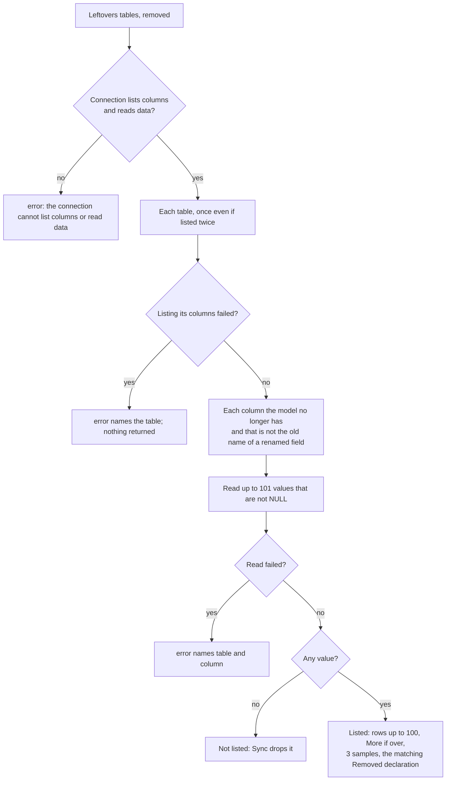

# Leftovers flow

`DB.Leftovers(tables, removed)` lists the columns a database keeps although the model no longer has them, because
they still hold data (`Sync` never drops those). You run into it when `webtyp dev` shows the DATABASE tab, or when a
production server warns at start. It only reads. Each branch has a test in `tests/leftovers_test.go`.

1. Without `TableIntrospector` and a DML half (`Compile` + `Query`) there is no evidence: it fails loudly.
2. A table that appears twice (two steps) is read once.
3. A column that is the old name of a renamed field (`db:"old_name=…"`) is `Sync`'s business: never listed.
4. Counting stops at 100: a production table is never read whole at start.
5. A `Removed` declaration whose table and column match is attached; one that matches nothing is ignored.
