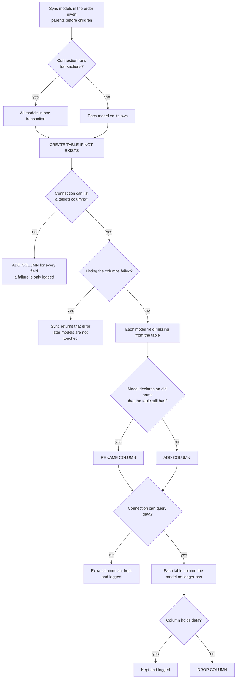

# Sync flow

`DB.Sync(models...)` is how a library or module migrates its tables: it creates a table that is missing, adds the
columns a model gained, renames a column the model declares as renamed, and drops a column only when it holds no data.
You run into it every time an app starts a new version: nobody writes migration files. This diagram is the contract
the tests of every consumer walk (each branch has a test).

